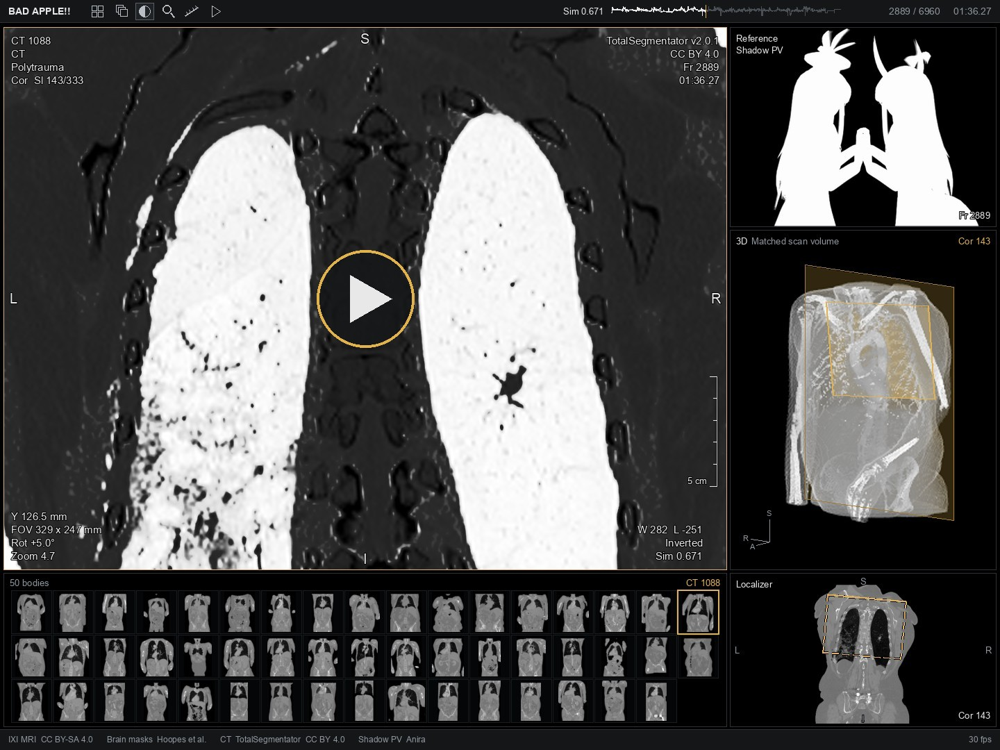

# Bad Apple!! but every frame is a medical scan

[](https://www.youtube.com/watch?v=FSPE6NNdRfk)

**[Watch the full video on YouTube](https://www.youtube.com/watch?v=FSPE6NNdRfk)**

Every frame of Bad Apple!! is matched to the closest crop from 250 MRI and CT volumes of 100 people, using de-identified public data: 50 brain MRIs from the IXI dataset (T1, T2, proton density and angiography) and 50 whole-body CTs from TotalSegmentator. CT heads are removed and MRIs are skull-stripped, so no faces can be reconstructed.

The video is laid out like a radiology workstation:
- **Viewport.** The matched crop, with orientation letters, window and level, field of view and a scale bar taken from the real scan.
- **Reference.** The original Bad Apple!! frame.
- **3D.** A volume render of the matched scan, with the slice plane and crop outlined.
- **Localizer.** The whole slice, with the crop's footprint.
- **Cohort strip.** All 50 brains or bodies, with the current one highlighted.

There is also a 1080x1920 layout for phone feeds ([example](docs/frame-2889-vertical.jpg)).

## Quick start

Needs Python 3.11 to 3.13, FFmpeg and about 7 GB of disk for the scans.

```sh
python3 -m venv .venv
.venv/bin/python -m pip install -r requirements.txt
.venv/bin/python -m mriapple fetch     # downloads and verifies the public scans
.venv/bin/python -m mriapple run       # matches and renders a 7-second excerpt
```

The full song is best matched on a CUDA GPU (about 2 hours on one H200), then rendered locally:

```sh
.venv/bin/python -m mriapple render --output output/full-song
.venv/bin/python -m mriapple render --output output/full-song --layout vertical --to output/vertical
```

## More

- [Technical notes](docs/TECHNICAL.md): search, scoring, CT preparation, GPU cluster runs, reproducing a frame and tests
- [Credits and licences](CREDITS.md)
